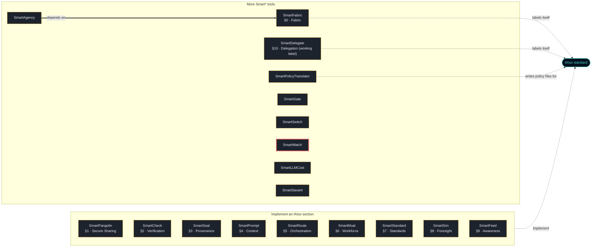

# SmartWatch

SmartWatch measures how densely the agents of a multi-agent system talk to each other while it runs. It
raises a graded alert as coordination intensifies. When the density stays at the reset level, it
proposes or issues a reset of the agents involved, before their coordination outgrows what a human can
follow.

- **Coupling density** is the number of messages per possible agent pair per second, in each window
  (1 s by default). It is reported as an integer in millionths. Unlike a raw message count, it does not
  grow just because more agents join.
- **Graded levels** are set by your policy (for example `elevated`, `high`, `critical`). Hysteresis
  keeps a level from flapping. Every level change goes to the audit log and to an optional webhook.
- **Resets.** When the density stays at the reset level for `sustain_ms`, the monitor names the agents
  of the hottest pairs. In `confirm` mode a human confirms, cancels or escalates within a deadline; in
  `auto` mode the reset goes out at once; `off` gives alerts only. The monitor never kills a process
  itself. A reset is a command that the agent's side pulls and acknowledges, or that a signed webhook
  delivers.
- **Bounded memory.** Counting is exact up to a configurable number of pairs and agents. Above that, the
  monitor switches to HyperLogLog sketches, hashed buckets and a bounded set of hot-pair candidates.
- **Thresholds come from your own traffic.** `sf-smartwatch calibrate` takes percentiles (p95/p99/p99.9
  for prod, p90/p95/p99 for staging) of the densities your system actually produced. The defaults are
  placeholders.
- **Evidence.** A hash-chained audit log records every level change, proposal, decision, reset and
  acknowledgement. There are Prometheus metrics and a read-only status page.

The engine is deterministic and specified in [spec/SEMANTICS.md](spec/SEMANTICS.md). It is implemented
in Python and in seven ports (Node.js, Go, Rust, Java, C#, PHP, Ruby), and all of them pass the same
1472 vectors.

## Install

```bash
python -m pip install sf-smartwatch
sf-smartwatch demo
```

Every file of `sf-smartwatch` on PyPI is built and published by this repository's release workflow
(`.github/workflows/release.yml`, PyPI trusted publishing). Each file carries a provenance attestation
that names this repository and that workflow; PyPI shows it under "Verified details". The same workflow
records a GitHub attestation, which you can check with
`gh attestation verify <file> --repo SmartTasksOrg/sf-smartwatch`. A release file without that
provenance is not ours, and neither is a package called `smartwatch` (without `sf-`) on any registry.

Version 0.1.0 is the first release under this name. If pip cannot find it yet, that release has not
finished. Install from a clone instead (Python 3.10 or later):

```bash
git clone https://github.com/SmartTasksOrg/sf-smartwatch
cd sf-smartwatch
python -m venv .venv
. .venv/bin/activate          # Windows PowerShell: .\.venv\Scripts\Activate.ps1
python -m pip install .
sf-smartwatch demo
```

The package has no runtime dependency. JWTs signed with RS256, ES256 or EdDSA need
[`cryptography`](https://pypi.org/project/cryptography/): `python -m pip install "sf-smartwatch[jwt]"`.
HS256 works without it.

The demo starts a monitor on 127.0.0.1 with five agents reporting over HTTP. Three of them start a burst
of coordination, and the demo then shows the level rising, the reset proposal, the confirmation, the
reset commands reaching the agents, the level falling back and the audit chain being checked. It takes
about 10 seconds and writes nothing to disk.

## Use it

```bash
# 1. thresholds from your own traffic (events as JSON lines, or windows from a running monitor)
sf-smartwatch calibrate --input traffic.jsonl --environment prod --profile prod --out policy.json \
    --configmap policy-configmap.yaml --namespace agents
sf-smartwatch validate policy.json

# 2. the monitor (behind a TLS proxy). Tokens: python -c "import secrets; print(secrets.token_urlsafe(32))"
export SMARTWATCH_INGEST_TOKEN=...            # reporters
export SMARTWATCH_OPERATOR_TOKEN=...          # operators: state, windows, proposals, /ui
export SMARTWATCH_JWT_HS256_SECRET=...        # or SMARTWATCH_JWT_PUBLIC_KEY=/path/idp.pem: who may reset
sf-smartwatch serve --policy policy.json --audit audit.jsonl --host 0.0.0.0 --port 8730

# 3. look and decide (SMARTWATCH_TOKEN: the operator token, or a JWT with scope reset:agent)
sf-smartwatch state --url https://watch.example
sf-smartwatch proposals --url https://watch.example --status open
sf-smartwatch decide --url https://watch.example p-0123abcd confirm --note "agreed with the on-call"
sf-smartwatch reset --url https://watch.example planner --reason "manual" --idempotency-key 2026-10-14-1
sf-smartwatch audit verify audit.jsonl
```

With no traffic of your own yet, `sf-smartwatch synth` writes synthetic traffic and `sf-smartwatch replay`
runs a file through the engine offline. [docs/calibration.md](docs/calibration.md) explains why
synthetic thresholds are no substitute for your own.

## Report traffic from your agents

```python
import os
from sf_smartwatch import Client, CommandPoller, Reporter

rep = Reporter("https://watch.example", token=os.environ["SMARTWATCH_INGEST_TOKEN"]).start()
rep.record("planner", "coder")        # wherever one agent sends a message to another; never blocks

def on_reset(cmd):                    # your own reset: clear the agent's context, restart its worker, ...
    restart_agent("coder")

CommandPoller(Client("https://watch.example", os.environ["SMARTWATCH_INGEST_TOKEN"]), "coder", on_reset).start()
```

The reporter adds up messages per pair and second and sends them every second, with up to 200 ms of
random jitter. The poller acknowledges a reset only after `on_reset` returned. If your traffic already
goes through Envoy, `sf-smartwatch ingest-log` turns its JSON access log into events; you name the
fields that carry the two agent ids. [docs/integration.md](docs/integration.md) covers both, the
webhooks and the in-process API.

## API

The monitor speaks HTTP. [spec/openapi.yaml](spec/openapi.yaml) is the contract.

| Endpoint | Credential | What |
|---|---|---|
| `POST /v1/events` | ingest | up to 10,000 events `{src, dst, ts_ms, count}`; bad ones are reported by index |
| `GET /v1/agents/{id}/commands` | ingest | pending reset commands for an agent |
| `POST /v1/resets/{id}/ack` | ingest | the agent's side confirms a reset |
| `GET /v1/state`, `/v1/windows?last=N`, `/v1/proposals`, `/v1/resets/{id}` | operator | what the monitor sees |
| `POST /v1/proposals/{id}/confirm`, `/cancel`, `/escalate` | reset | a human decision |
| `POST /api/v1/agents/{id}/reset` | reset | a manual reset; `202`, `Idempotency-Key` honoured |
| `GET /ui` | operator (HTTP Basic) | read-only status page, no script |
| `GET /metrics`, `/healthz` | none | Prometheus metrics, liveness |

The "reset" credential is a JWT with the scope `reset:agent` when a JWT key is configured. In that case
the operator token is not enough. Without a JWT key, the operator token is the reset credential.

## Ports

| Port | Directory | Engine and vectors | Reporter, poller, interop |
|---|---|---|---|
| Node.js | `ports/node` | yes | yes |
| Go | `ports/go` | yes | yes |
| Rust | `ports/rust` | yes | yes (plain HTTP only) |
| Java | `ports/java` | yes | yes |
| C# | `ports/csharp` | yes | yes |
| PHP | `ports/php` | yes | yes (`tick()` driven, no threads) |
| Ruby | `ports/ruby` | yes | yes |

The ports use only their standard libraries. None is published on a registry; use them from a clone.
`ports/conformance/run.sh` runs the vectors on every engine whose toolchain is installed, and
`ports/conformance/interop.sh` runs each port's reporter and poller against the Python monitor.
[spec/PORTING.md](spec/PORTING.md) says what a port must contain.

## Deploy and measure

`Dockerfile` builds the monitor image. `deploy/docker-compose.yml` adds Prometheus with alert rules and
a Grafana dashboard ([docs/operations.md](docs/operations.md)). `sf-smartwatch bench` times the engine
on your machine. On the Linux machine this release was built on (Python 3.13), it measured roughly
340,000 to 500,000 events/s with exact counting and 20 agents, roughly 250,000 to 280,000 events/s
through `Watcher.ingest` in batches of 1,000, and roughly 58,000 events/s in sketch mode with 5,000
agents. These numbers come from one machine, so run the benchmark on yours.

## Status

- **Version 0.1.0, experimental.** It ships the engine, the HTTP monitor, the reporter and poller, a
  command line, seven ports and deployment files.
- **Published:** PyPI `sf-smartwatch` (see Install). Nothing else is published.
- **Tested:**
  - The Python tests (`tests/`) on Python 3.10, 3.12 and 3.13 and the install-line check gate every
    pull request (`.github/workflows/ci.yml`).
  - The `ports` job runs the vectors on all eight engines and interop on all seven ports. It does not
    gate merges yet.
  - Locally (Linux), all eight engines passed all vectors and all seven ports passed interop.
  - `nightly.yml` runs everything at 02:00 UTC, plus a 30-minute synthetic replay.
- **Not tested:**
  - the Docker image and the compose stack (not run by CI);
  - Windows and macOS for the monitor;
  - real multi-agent deployments;
  - the council's resource envelopes (under 2 % CPU, under 5 ms p99, at most 10 MB for 20k agents),
    which were not measured. SmartWatch is not a sidecar: the reporter runs in the agent's process and
    the monitor runs as one service.
- **Changed from the council's specification** ([docs/decisions.md](docs/decisions.md)):
  - a JSON policy file instead of OPA;
  - a hash-chained JSON Lines audit log instead of a PostgreSQL table;
  - reporters and an access-log ingester instead of a transport-layer sidecar;
  - a pull/webhook reset command instead of the monitor resetting pods itself;
  - the confirmation dialog is the API and CLI, not a Grafana modal.
- **Not done from the council's notes:**
  - the Envoy filter;
  - Kubernetes manifests, Helm and HPA (the calibrate command writes a ConfigMap);
  - Cortex retention;
  - a ground-truth payload logger;
  - PagerDuty, Slack and email integrations (the webhooks and Prometheus alerts feed whatever you use);
  - a 20k-agent load test.
- **Security review:** one pre-release review of the code by a separate AI reviewer that did not write
  it; its findings were fixed or documented (see CHANGELOG). No independent human audit. Report vulnerabilities as described in
  [SECURITY.md](SECURITY.md).

## The Smart* family

<!-- smart-family:start -->
<!-- generated by fleet-docs from family.json; change family.json, not this block -->

18 open-source tools by SmartTasks Lab, each standalone, plus the [IAIso standard](https://github.com/SmartTasksOrg/IAISO). Every tool is on PyPI under its `sf-` name; a package without the `sf-` prefix is not ours.

| Tool | IAIso | What it does |
|---|---|---|
| [SmartPangolin](https://github.com/SmartTasksOrg/sf-smartpangolin) | §1 · Secure Sharing | Scan before you share. Stop leaking secrets into AI models, agents, and tools. |
| [SmartCheck](https://github.com/SmartTasksOrg/sf-smartcheck) | §2 · Verification | Check before you sign off. Catch the AI when it's confidently wrong. |
| [SmartSeal](https://github.com/SmartTasksOrg/sf-smartseal) | §3 · Provenance | Seal what you ship. A signed receipt so anyone can verify what they received. |
| [SmartPrompt](https://github.com/SmartTasksOrg/sf-smartprompt) | §4 · Context | Lint before you send. Bad prompt in, bad work out — and it's your name on it. |
| [SmartRoute](https://github.com/SmartTasksOrg/sf-smartroute) | §5 · Orchestration | Route only what you trust. Gate agents and tools with trust scores and guardrails. |
| [SmartMoat](https://github.com/SmartTasksOrg/sf-smartmoat) | §6 · Workforce | Know your moat. Score the tasks AI can't easily take — and widen them. |
| [SmartStandard](https://github.com/SmartTasksOrg/sf-smartstandard) | §7 · Standards | Standardize before you scale. One shared, auditable convention for AI-assisted work. |
| [SmartSim](https://github.com/SmartTasksOrg/sf-smartsim) | §8 · Foresight | Simulate before it hits you. See your role's task-by-task collapse sequence. |
| [SmartFeed](https://github.com/SmartTasksOrg/sf-smartfeed) | §9 · Awareness | Distill the firehose. A tight brief of only what moves your work. |
| [SmartFabric](https://github.com/SmartTasksOrg/sf-smartfabric) | §0 · Fabric | IAIso Fabric Protocol (IFP) — carry & enforce IAIso containment across a fleet of governed AI nodes. |
| [SmartDelegate](https://github.com/SmartTasksOrg/sf-smartdelegate) | §10 · Delegation (working label) | Delegate, don't hand over the keys. An agent never holds more than the human's role for the task: IAM for LLM agents. |
| [SmartPolicyTranslator](https://github.com/SmartTasksOrg/sf-smartpolicytranslator) | writes IAIso policy files | Translate natural-language regulation into REAL, schema-conformant IAIso policy files. |
| [SmartAgency](https://github.com/SmartTasksOrg/sf-smartagency) | — | Signed contracts that say what an AI agent may do, a ledger to suspend and revoke them, and a monitor that enforces them on every action, with SmartFabric pressure limits. |
| [SmartGate](https://github.com/SmartTasksOrg/sf-smartgate) | — | Decision friction and a human override for AI agents: score each action, ask a person before risky ones, kill any action or agent with one logged call. |
| [SmartSwitch](https://github.com/SmartTasksOrg/sf-smartswitch) | — | A quorum kill switch for AI agent fleets: no single keyholder can halt the fleet or block a halt; every agent verifies the signatures itself and stops when cut off. |
| **[SmartWatch](https://github.com/SmartTasksOrg/sf-smartwatch)** (this repository) | — | Coupling-density monitor for multi-agent systems: measures how densely agents talk to each other, raises graded alerts, and proposes or issues resets before coordination outgrows human oversight. |
| [SmartLLMCost](https://github.com/SmartTasksOrg/sf-smartllmcost) | — | Apples-to-apples LLM cost & performance benchmark — cost per successful task, reproducible. |
| [SmartSavant](https://github.com/SmartTasksOrg/sf-smartsavant) | — | A model-agnostic design council: stakeholder views and a juror merge per design-sprint phase, schema-checked adapter answers, exports (spec, stories, decision tree, trainset) and audits of council runs before anyone builds or trains from them. |



Thick arrow: the package requires the other one in its `pyproject.toml`. Dashed arrow: what the tool's README states about IAIso. A tool with no thick arrow does not depend on any other family package; each one installs and runs on its own.

<!-- smart-family:end -->

## Contributing, security, licence

[CONTRIBUTING.md](CONTRIBUTING.md) · [SECURITY.md](SECURITY.md) · [CODE_OF_CONDUCT.md](CODE_OF_CONDUCT.md) ·
Apache-2.0 ([LICENSE](LICENSE), [NOTICE](NOTICE)).
